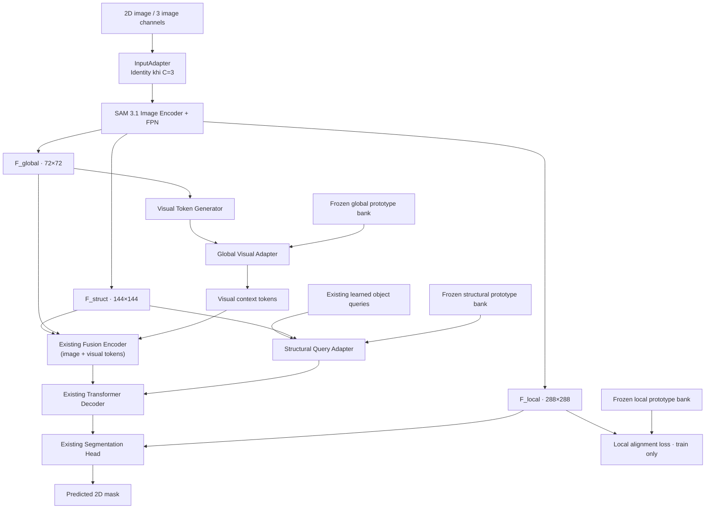

# THIẾT KẾ HPMA IMAGE-ONLY 2D VỚI SAM 3.1

> **Mục tiêu:** giữ tối đa kiến trúc và codebase HPMA/SAM 3.1 hiện có, nhưng loại bỏ hoàn toàn text khỏi đầu vào và khỏi đường suy luận. Hệ thống là phân vùng 2D chỉ dựa trên ảnh.
>
> **Thay đổi lõi:** thay `Text Encoder + GlobalPromptAdapter` bằng `Visual Token Generator + GlobalVisualAdapter`. Các token điều kiện được sinh từ feature ảnh toàn cục `F_global`, không phải từ text prompt.

## 1. Phạm vi và các quyết định bất biến

Hệ thống nhận ảnh 2D đã chuẩn hóa và tạo mask phân vùng:

\[
I \in \mathbb{R}^{B\times C\times H\times W}
\xrightarrow{f_\Theta}
\hat{Y}\in[0,1]^{B\times 1\times H\times W}.
\]

Trong cấu hình SAM 3.1 hiện tại, `C=3` và `H=W=1008`. Với ảnh RGB, ba kênh được dùng trực tiếp. Với ISLES-2022, mỗi lát 2D dùng `[DWI, ADC, FLAIR]` làm ba kênh; không đổi hệ thống sang mô hình 3D. Dataset khác có số kênh khác 3 dùng một `InputAdapter` học được để chiếu `C_raw → 3` trước SAM Image Encoder.

Các nguyên tắc không được vi phạm:

- `model.forward(...)` chỉ nhận `images` ở inference. Không nhận text, `prompt_ids`, `text_prompt_ids`, click, box, mask, `label` hay prototype được caller chọn theo nhãn.
- Nhãn ground truth chỉ được dùng khi build memory từ train split, tính loss lúc train và metric lúc validation/test.
- Giữ backbone SAM 3.1 2D, FPN 3 mức, Fusion Encoder, Transformer Decoder, Segmentation Head, local alignment loss và cơ chế freeze hiện hữu khi chúng còn phù hợp.
- Không đưa logic 3D vào model. Việc đọc NIfTI ISLES (nếu dùng) nằm ở dataset adapter để tách thành các mẫu 2D; split vẫn phải theo ca bệnh, không theo lát.

| Thành phần | Codebase cũ | Thiết kế image-only |
| --- | --- | --- |
| Input model | `images` + `text_prompt_ids` + prototype theo class | `images` duy nhất |
| Nguồn token điều kiện | SAM Text Encoder | `F_global` của ảnh hiện tại |
| Global adapter | Text query ↔ global prototype | Visual token query ↔ global prototype |
| Fusion Encoder | Image–text fusion | Image–visual-context fusion, giữ API/khối fusion |
| Structural adapter | Prototype của nhãn được chọn | Prototype truy hồi bằng summary feature ảnh |
| Memory lúc inference | Chọn `P[c]` bằng `label` | Attention trên toàn bộ bank, không có label |
| Không gian xử lý | 2D | Giữ 2D |

## 2. Dữ liệu 2D và hợp đồng API

### 2.1. Dataset độc lập với text

Một mẫu train/validation chuẩn:

```python
{
    "image": Tensor[C, H, W],
    "mask": Tensor[1, H, W],
    "label": Tensor[...] ,  # chỉ train/memory/metric; không truyền vào model
    "sample_id": str,
}
```

Một mẫu inference không có trường nhãn:

```python
{
    "image": Tensor[C, H, W],
    "sample_id": str,
}
```

`label` chỉ cần thiết nếu dataset là semantic/multi-class và local alignment cần chọn prototype đúng lớp trong loss. Với bài toán nhị phân như lesion foreground/background, có thể cố định `label=0` bên trong loss train hoặc dùng bank chỉ có một lớp foreground. Nó không được dùng để quyết định forward output.

`prompt_ids` từng được tạo ngẫu nhiên trong `data/dataset_endovis.py`; trường này đã được loại khỏi dataset, dataloader, `train.py`, `eval.py` và test. Không thay bằng một chuỗi text rỗng hoặc token học được độc lập với ảnh: điều đó vẫn là một prompt pathway không cần thiết.

### 2.2. ISLES-2022 trong luồng 2D

ISLES-2022 có DWI, ADC, FLAIR và nhãn `derivatives/*_msk.nii.gz` theo từng case. Để giữ full 2D:

1. Dataset loader kiểm tra orientation, affine, spacing và shape; resample ADC, FLAIR và mask về lưới của modality tham chiếu nếu cần.
2. Mỗi index mẫu là một lát `z` của một ca, với input `image[:, z, :, :] = [DWI, ADC, FLAIR]` và mask tương ứng.
3. Normalization làm riêng theo modality/case, sau đó resize ảnh và mask về 1008×1008 theo quy tắc SAM; mask dùng nearest-neighbor.
4. Không dùng lát làm đơn vị chia train/validation/test. Toàn bộ lát của một case phải ở cùng split để tránh leakage.
5. Có thể loại hoặc giảm xác suất lát không có lesion ở train để xử lý mất cân bằng, nhưng validation/test phải duyệt toàn bộ lát.

Mô hình chỉ thấy một ảnh 2D ba kênh. Việc xếp ba MRI modality là xếp **kênh ảnh**, không phải text hoặc prompt. Dataset RGB thông thường vẫn dùng pipeline tương tự với `C=3`.

### 2.3. Input adapter tùy chọn

SAM 3.1 hiện nhận ba kênh. Để mở rộng sang dataset 1 kênh hoặc nhiều hơn ba kênh mà không sửa Image Encoder, dùng:

\[
I_{sam}=A_{in}(I_{raw}),\qquad
A_{in}:\mathbb{R}^{C_{raw}\times H\times W}\rightarrow\mathbb{R}^{3\times H\times W}.
\]

`A_in` là `1×1 Conv2d` trainable, theo sau bởi normalization nhẹ. Khi `C_raw=3`, mặc định dùng `Identity` để giữ thay đổi nhỏ nhất. Adapter này thay đổi **đầu vào ảnh**, không phải module thay text.

## 3. Kiến trúc giữ nguyên và vị trí thay thế text

### 3.1. Sơ đồ tổng thể



Các khối được giữ nguyên về vai trò và đường dữ liệu chính:

- `vision_encoder` trả `[F_local, F_struct, F_global]` như `models/hpma_model.py` hiện tại.
- `fusion_encoder`, `transformer_decoder` và `segmentation_head` vẫn dùng. Với official SAM 3.1, cần inspect đúng tên/tham số module trước khi gắn adapter; mock trong repository chỉ là interface phát triển.
- `StructuralQueryAdapter`, `LocalProjectionAdapter`, `PrototypeMemoryBank`, `PrototypeMemoryBuilder` và `HPMATotalLoss` được sửa có kiểm soát, không thay thế bằng kiến trúc 3D mới.

Text Encoder bị loại khỏi `HPMAModel`: không tạo `self.text_encoder`, không unfreeze language layers, không thêm vào optimizer. Nếu checkpoint/builder bắt buộc dựng full SAM trước, module text phải bị bỏ reference sau khi bóc các image submodule để giải phóng VRAM.

### 3.1.1. Giới hạn quan trọng của `MockSAM3Model`

`models/sam3/mock_sam3.py` là mock kiểm tra interface/shape, không phải mô phỏng đầy đủ SAM 3.1. Mock hiện có đưa pooled `fused_features` vào object queries và điều kiện hóa `F_local` bằng `mask_queries`, để các nhánh global/structural có ảnh hưởng tới mask đầu ra trong kiểm tra tích hợp. Tuy vậy, năng lực này không biến mock thành backbone SAM có giá trị huấn luyện.

Không dùng kết quả train hoặc ablation trên mock để kết luận hiệu quả kiến trúc. Ưu tiên checkpoint/module SAM 3.1 chính thức và xác nhận Fusion Encoder → Decoder → Mask Head có dependency tương ứng. Kiểm tra bằng mock xác nhận hợp đồng API và shape, không thay thế đánh giá ngữ nghĩa trên model SAM thật.

### 3.2. Visual Token Generator — phần thay thế Text Encoder

Mục đích của Text Encoder cũ là tạo tensor điều kiện `[B, L, D]` cho Fusion Encoder. Ta thay đúng hợp đồng shape đó bằng token thị giác:

\[
T_v = \operatorname{flatten}(\operatorname{AdaptivePool}_{h_t\times w_t}(F_g))
\in\mathbb{R}^{B\times L_v\times d},\qquad L_v=h_t w_t.
\]

Ví dụ `h_t=w_t=4` tạo 16 visual tokens, cùng độ dài mà test hiện tại đang dùng cho `text_ids`, nhưng không có tokenization. Sau pooling, áp dụng `LayerNorm + Linear` để khớp embedding space của Fusion Encoder:

\[
T_v = W_v\operatorname{LN}(T_v).
\]

`VisualTokenGenerator` chỉ thêm một module nhỏ. Nó dùng ảnh hiện tại nên token thay đổi theo ca/lát và mang thông tin ngữ cảnh toàn cục; đây tốt hơn một vector học được cố định khi không có text.

### 3.3. Global Visual Adapter — phần thay thế Global Prompt Adapter

Giữ nguyên tinh thần cross-attention và frozen global prototypes của `GlobalPromptAdapter`, nhưng thay `text_feature` bằng `visual_tokens`:

\[
Q=W_Q\operatorname{LN}(T_v),\qquad
K,V=\Phi_g(P_g),
\]
\[
A=\operatorname{softmax}\left(\frac{QK^\top}{\sqrt d}\right),\qquad
\tilde T_v=T_v+\alpha_gW_O(AV).
\]

`P_g` phải chứa **toàn bộ** global bank `[N_{class}·K, D]` (hoặc `[K,D]` cho binary), sau đó batch-expand. Adapter attention tự chọn prototype liên quan nhất với ảnh. Nó không nhận `class_idx`/`label` và không biết ground truth ở inference.

Thay đổi mã tối thiểu là đổi tên/triển khai `GlobalPromptAdapter` thành `GlobalVisualAdapter`, giữ projection, attention và learnable gate hiện có. Thay đổi duy nhất ở signature là:

```python
# Cũ
t_tilde = global_adapter(t_c, p_global)       # t_c từ text encoder

# Mới
visual_tokens = visual_token_generator(f_global)
visual_tokens = global_visual_adapter(visual_tokens, p_global_all)
```

`p_global_all` là buffer thuộc model hoặc memory bank đã nạp, không phải input theo từng sample. Khi giữ Fusion Encoder hiện tại, truyền `visual_tokens` vào vị trí đối số thứ hai trước đây tên là `text_features`; khi refactor interface, đổi tên thành `condition_features` để tránh hiểu nhầm semantics.

### 3.4. Structural Query Adapter không phụ thuộc nhãn

Trong code cũ, train/eval gọi `memory_bank.get_class_prototypes(c_idx)` từ `labels` và truyền `p_struct` vào adapter. Đây là leakage ở inference. Thay bằng visual retrieval:

\[
q_s=W_s\operatorname{GAP}(F_s),\qquad
a_s=\operatorname{softmax}(q_sK_s^\top/\sqrt d),\qquad
r_s=a_sV_s,
\]
\[
\tilde Q=Q_{obj}+\alpha_s\Phi_s(r_s).
\]

`K_s,V_s` là projection của toàn bộ `P_struct`. Có thể đưa retrieval vào trong `StructuralQueryAdapter` để giữ forward model gọn:

```python
queries = decoder.get_object_queries(batch_size)
q_tilde = structural_adapter(queries, f_struct, p_struct_all)
```

Nếu cần thay đổi ít hơn nữa, dùng `GAP(F_struct)` làm trọng số cosine/softmax để tổng hợp `p_struct_all` thành `[B, 1, D]`, sau đó tái sử dụng MLP residual và gate đang có. Không được dùng trung bình mù toàn bộ prototype, vì nó làm mất khả năng chọn priors phù hợp theo ảnh.

### 3.5. Local alignment vẫn chỉ ở train

Local branch vẫn dùng `F_local` và `LocalProjectionAdapter`. Nó không ảnh hưởng input inference và không tăng latency inference.

Với binary segmentation, memory local có một bank foreground và local loss căn chỉnh masked pooled feature với prototype gần nhất. Với semantic/instance dataset, `labels` chỉ được phép chọn prototype trong **loss** theo ground truth:

\[
\mathcal{L}_{align}=\frac1N\sum_i\min_k\left[1-\cos\left(
\operatorname{MAP}(F_l,M_i),\Phi_l(P^l_{c_i,k})\right)\right].
\]

Quy tắc quan trọng: `M_i` và `c_i` không được truyền vào `HPMAModel.forward`; `HPMATotalLoss` mới được nhận chúng. Vì vậy đường suy luận vẫn chỉ là ảnh.

## 4. Prototype memory image-only

### 4.1. Xây bank offline

Giữ `memory/builder.py` và FPN scales hiện hữu:

- Local: `F_local` — 288×288.
- Structural: `F_struct` — 144×144.
- Global: `F_global` — 72×72.

Builder dùng mask train để masked average pool, L2-normalize vector và K-Means theo scale/lớp. Bank duy trì shape hiện có:

\[
P\in\mathbb{R}^{3\times N_{class}\times K\times d}.
\]

Khác biệt bắt buộc là API inference lấy `P[s].reshape(N_class·K, d)` thay vì chọn prototype bằng `class_idx`. `LocalAlignmentLoss` nhận toàn bộ `local_prototypes` và dùng ground-truth label bên trong loss; memory bank không cần expose API lấy prototype theo lớp.

Mỗi fold phải build bank chỉ từ train split. Với ISLES full-2D, mọi lát của validation/test case bị loại khỏi builder. Memory là `register_buffer` frozen, không phải `nn.Parameter`.

### 4.2. Hỗ trợ binary và multi-class

Code Segmentation Head hiện xuất một mask `[B,1,H,W]`, vì vậy đường triển khai tối thiểu là binary foreground segmentation. Đây phù hợp lesion segmentation hoặc một foreground class tại một lần chạy.

Để hỗ trợ semantic multi-class trong tương lai mà vẫn image-only, sửa head thành `[B,N_class,H,W]` và loss thành cross-entropy/Dice đa lớp. Visual adapters không đổi: chúng luôn attend toàn bộ bank; không thêm lại text hay class ID vào forward. Đây là mở rộng của head/loss, không phải thay đổi sang 3D.

## 5. Forward, loss và trạng thái tham số

### 5.1. Forward contract mới

```python
def forward(self, images: torch.Tensor) -> dict[str, torch.Tensor]:
    images = self.input_adapter(images)
    f_local, f_struct, f_global = self._extract_fpn(images)

    visual_tokens = self.visual_token_generator(f_global)
    visual_tokens = self.global_visual_adapter(
        visual_tokens, self.prototype_bank.global_all()
    )
    fused_features = self.fusion_encoder([f_struct, f_global], visual_tokens)

    queries = self.transformer_decoder.get_object_queries(images.shape[0])
    queries = self.structural_adapter(
        queries, f_struct, self.prototype_bank.structural_all()
    )
    mask_queries = self.transformer_decoder(fused_features, queries)
    pred_masks = self.segmentation_head(mask_queries, f_local)
    return {"pred_masks": pred_masks, "high_res_features": f_local}
```

Đây là pseudocode hợp đồng; tên method chính xác phải khớp module SAM 3.1 thực tế sau khi chạy `tools/inspect_sam3_structure.py`. Nó minh họa ba điểm bắt buộc: không Text Encoder, không label, không prototype per-class từ caller.

### 5.2. Training step

```python
images = batch["image"].to(device)
gt_masks = batch["mask"].to(device)
labels = batch.get("label")          # chỉ dùng bởi criterion khi cần

outputs = model(images)                # input duy nhất của model
loss_dict = criterion(
    outputs["pred_masks"],
    outputs["high_res_features"],
    gt_masks,
    labels,
    model.prototype_bank.local_prototypes,
)
```

`train.py` không còn đọc `batch["prompt_ids"]`, không tạo `p_global_list`/`p_struct_list`, và không gọi `memory_bank.get_class_prototypes()` trước forward. `eval.py` cũng gọi duy nhất `model(images)`; nhãn chỉ đi vào metric.

Hàm mục tiêu giữ cấu trúc đơn giản của codebase:

\[
\mathcal{L}=\mathcal{L}_{seg}+\lambda_{align}\mathcal{L}_{align},\qquad
\mathcal{L}_{seg}=\mathcal{L}_{focal}+\mathcal{L}_{dice}.
\]

Không cần box, GIoU, classification/presence loss vì output hiện tại là binary dense mask. Có thể tune `lambda_align` trên validation, nhưng không thay đổi API inference.

### 5.3. Freeze/trainable

| Thành phần | Trạng thái | Lý do |
| --- | --- | --- |
| Prototype bank | Frozen | Tri thức visual build offline từ train split |
| SAM Image Encoder | Freeze phần lớn; có thể mở 4 trunk block cuối | Giữ đúng selective fine-tuning hiện có |
| SAM Text Encoder | Loại khỏi `HPMAModel` | Không được dùng |
| Fusion Encoder | Freeze phần lớn; có thể mở 2 layer cuối | Nay fuse image feature và visual tokens |
| Transformer Decoder | Trainable | Giữ thiết kế hiện có |
| Segmentation Head | Frozen theo code hiện tại | Chỉ thay khi ablation chứng minh cần mở |
| InputAdapter, VisualTokenGenerator | Trainable | Module mới, rất nhẹ |
| GlobalVisualAdapter, StructuralQueryAdapter, LocalProjectionAdapter | Trainable | Adapter thị giác |

Nhóm optimizer phải xóa learning-rate group `language_backbone`; thêm group cho các adapter mới ở base learning rate. Không gọi `_apply_selective_freezing` trên text encoder nữa.

## 6. Các thay đổi file tối thiểu

| File hiện tại | Thay đổi cần thiết |
| --- | --- |
| `models/hpma_model.py` | Bỏ `text_encoder`, bỏ các đối số text/prototype per-sample; thêm `InputAdapter`, `VisualTokenGenerator`, bank nội bộ và visual adapter. |
| `models/adapters/global_adapter.py` | Đổi semantics/class thành `GlobalVisualAdapter`; tái sử dụng cross-attention, MLP và gate. |
| `models/adapters/structural_adapter.py` | Nhận `F_struct` và full structural bank để retrieve prototype theo ảnh. |
| `memory/prototype_bank.py` | Thêm `global_all()`/`structural_all()` trả `[N_class·K,D]`; local loss nhận toàn bộ local bank. |
| `train.py` | Xóa `prompt_ids`, `p_global`, `p_struct`; gọi `model(images)`. |
| `eval.py` | Xóa label-conditioned prototype retrieval; gọi `model(images)`. |
| `data/dataset_endovis.py` | Không trả dummy `prompt_ids`; label chỉ còn đường train/loss. |
| `data/dataset_isles2d.py` | NIfTI → từng lát 2D `[DWI,ADC,FLAIR]`, resample về lưới DWI và split theo case. |
| `configs/base_config.yaml` | Xóa `unfreeze_language_blocks` và `language_backbone` LR; thêm visual-token/input-adapter config. |
| `tests/test_model_forward.py` | Chỉ tạo `images`, xác nhận `model(images)` và không cần labels/text. |

Không đổi tên hoặc xóa ngay các file legacy EndoVis/SAM nếu điều đó làm gián đoạn repository. Tuy nhiên chúng phải được đánh dấu deprecated sau khi image-only path có test, để scripts không vô tình chạy prompt pipeline cũ.

## 7. Cấu hình khởi điểm 2D

```yaml
data:
  input_resolution: [1008, 1008]
  input_channels: 3
  isles_2d_channels: [dwi, adc, FLAIR]
model:
  feature_dim: 256
  num_prototypes_k: 4
  visual_token_grid: [4, 4]       # 16 tokens, thay text sequence
  use_input_adapter: false        # false khi C_raw = 3
  unfreeze_vision_blocks: 4
  unfreeze_fusion_layers: 2
training:
  learning_rate:
    base: 8.0e-5
    vision_backbone: 2.5e-5
  loss_weights:
    lambda_align: 0.01
```

Kích thước 1008, FPN 72/144/288 và `K=4` được giữ để tương thích codebase/paper hiện tại. Chúng là điểm khởi đầu, không phải giả định dành cho mọi dataset. Với ảnh nhỏ hơn, resize/padding phải giữ tỉ lệ và dùng cùng transform cho mask.

## 8. Kiểm thử và tiêu chí nghiệm thu

Các kiểm thử bắt buộc sau refactor:

1. `HPMAModel(images)` chạy với tensor `[B,3,1008,1008]`; output là `pred_masks [B,1,1008,1008]` và `high_res_features [B,256,288,288]`.
2. Không có import/call nào của `text_encoder`, tokenizer hoặc `prompt_ids` trên đường train/eval/inference image-only.
3. Thay đổi `label` hoặc `mask` trong batch không thể đổi kết quả `model(images)` ở `eval()`.
4. `PrototypeMemoryBank.global_all()` và `structural_all()` không dùng ground truth hoặc case ID; chỉ đọc frozen buffer.
5. Bank của mỗi fold được build bằng train cases; toàn bộ lát thuộc validation/test cases không xuất hiện trong builder.
6. So sánh ít nhất ba ablation trên cùng split: (a) SAM image-only không memory, (b) global visual adapter, (c) global + structural + local alignment.

Đánh giá theo nhiệm vụ: binary dùng Dice/IoU/precision/recall; multi-class dùng Dice/IoU theo lớp. Với ISLES 2D, có thể tổng hợp dự đoán lát về volume để báo cáo metric theo ca, nhưng đây là bước dataset/evaluation ngoài `HPMAModel` 2D.

## 9. Lộ trình triển khai an toàn

1. Sửa model/test để `model(images)` chạy image-only trên mock SAM; giữ nguyên shape và mask output.
2. Chuyển `GlobalPromptAdapter` sang `GlobalVisualAdapter`, thêm `VisualTokenGenerator`, sau đó xác nhận Fusion Encoder nhận đúng `[B,L,D]`.
3. Chuyển structural retrieval từ `label → P[c]` sang `F_struct → attention(P_all)`; xóa retrieval theo label trong `train.py` và `eval.py`.
4. Đưa bank vào model/buffer hoặc một wrapper inference cố định; không để caller cung cấp prototype được chọn bằng nhãn.
5. Cập nhật dataset/config/script và test image-only; ISLES 2D dùng split cố định theo ca, không theo lát.
6. Train baseline không memory trước, rồi thêm từng adapter để xác minh mỗi thành phần có ích.

Tài liệu này thay thế toàn bộ thiết kế prompt/text trước đó. SAM 3.1 vẫn là backbone 2D trung tâm; phần duy nhất bị thay thế về chức năng là nhánh tạo điều kiện từ text, nay được tạo hoàn toàn từ feature thị giác của chính ảnh đầu vào.
